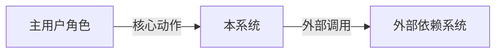
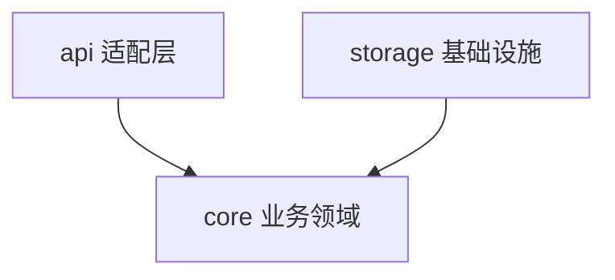
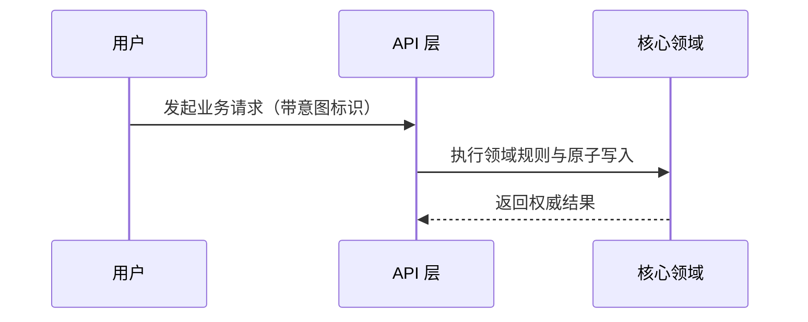

# Architecture Design — {{项目名}}

> 生成：{{日期}} · 档位：{{S/M/L}} · 模式：{{Coaching / Fast}} · 状态：待批准
> 本文档只记录跨单元稳定不变量；L 档依赖与禁边以 `.cac/harness/module-catalog.json` 为机器执行版。
> 五个必需二级段名不可更改（`predev-lint.mjs` 机器检查）：`架构概览` / `模块划分` / `依赖规则` / `运行与部署包络` / `关键决策记录`；每条 `### ADR-*` 必含 `**背景` / `**决策**` / `**被拒备选` / `**执法方式**`。生成时替换所有 `{{...}}` 占位槽！

## 1. 架构概览

- **架构风格与命名范式**：{{如：模块化单体 / 六边形端口适配器}}（目录映射：{{api/ → 适配层，domain/ → 核心领域，storage/ → 仓储实现}}）
- **技术栈（经查证钉死版本）**：

| 层级/组件 | 技术选型 | 版本 | 职责说明 |
|---|---|---|---|
| {{语言/运行时/框架/存储}} | {{名称}} | {{版本}} | {{职责}} |

- **一句话核心数据流**：{{请求入口 → 校验与核心处理模块 → 权威持久化 → 下游消费}}
- **系统上下文图**：



## 2. 模块划分

| 模块 id | 一句话职责 | 对外契约 | dependsOn | 禁依赖（forbidden） | 变化原因（SRP） | riskTier | 设计详述 |
|---|---|---|---|---|---|---|---|
| `{{core}}` | {{职责}} | {{导出接口}} | {{依赖模块}} | {{禁碰模块}} | {{唯一变化轴}} | `low/medium/high` | {{`docs/design/xx-设计.md` 或 `无`}} |



## 3. 依赖规则

- **分层方向（外 → 内，只许向内依赖）**：`{{api}}` → `{{service}}` → `{{domain}}` ← `{{storage 实现 domain 接口}}`
- **显式禁边**：{{如：analytics 严禁直连 pii-store；前端严禁跨过 service 直调 storage}}
- **权威数据归属（Single Writer）**：{{明确每张核心表/状态的唯一写入模块，其余模块只读契约}}

## 4. 一致性约定

| 关注点 | 跨模块统一约定 |
|---|---|
| 命名规范（实体 / 文件 / 接口 / 事件） | {{具体规则}} |
| 数据与错误信封（ID / 时间戳时区 / 金额单位 / 错误码结构） | {{具体规则}} |
| 状态与横切关注点（并发版本控制 / 日志脱敏 / 配置读取 / 鉴权入口） | {{具体规则}} |

## 5. 扩展点（开闭原则落点）

| 已确认易变轴 | 扩展机制 | 新增一种实现时改哪里 |
|---|---|---|
| {{如：导出格式}} | {{策略注册表}} | {{新增单个实现文件并注册，不改核心调度}} |

## 6. 关键业务场景走查

### 场景 1：{{核心路径及中断/超时恢复走查}}
{{简述正常提交与超时未知/部分成功时各模块保存的状态及恢复方式}}



## 7. 运行与部署包络

| 包络维度 | 状态（决定 / 押后 / 未定） | 具体结论或押后触发条件 |
|---|---|---|
| 运行环境（本地 / 测试 / 生产系统与平台） | {{决定}} | {{如：Windows PowerShell + Linux 双平台 Node >= 20}} |
| 部署拓扑（单进程 / 容器 / 多实例） | {{决定 / 押后}} | {{具体拓扑或触发条件}} |
| 基础设施与外部供应商 | {{决定 / 押后}} | {{数据库/对象存储/第三方服务}} |
| 运维保障（日志 / 健康探针 / 备份与回滚） | {{决定 / 押后}} | {{具体方式}} |

## 8. 关键决策记录（ADR）

| 已定但无需立 ADR 的常规结论 | 结论 | 一句话理由 |
|---|---|---|
| {{如：单机内嵌存储}} | {{SQLite}} | {{内部双人使用，无实质竞争备选}} |

### ADR-1：{{重大架构决策标题}}
- **状态**：accepted
- **背景与问题**：{{故障后果、团队维护能力与核心约束}}
- **决策驱动**：{{关键质量属性或业务不变量}}
- **候选对比**：
  - 方案 A（{{名称}}）：优势 {{…}}；代价 {{…}}
  - 方案 B（{{名称}}）：优势 {{…}}；代价 {{…}}
- **决策**：采用方案 {{A}}，因为 {{满足哪条核心驱动}}
- **被拒备选与理由**：不选方案 {{B}}，因为 {{具体代价或维护风险}}
- **执法方式**：{{如：`arch-check` / `layers` / `forbiddenDependencies` / `人工评审`}}
- **revisit-if**：{{客观失效条件，如：并发写入超过 500 QPS 或团队扩充至多独立小组}}
- **reversal**：{{撤回步骤与预估工期；若不可逆则明确写 `单向门` 并在 §10 点名}}

## 9. 押后决定（Deferred）

| 押后事项 | 为什么现在不用定 | 什么条件出现时回来定 |
|---|---|---|
| {{事项}} | {{不影响跨模块兼容性}} | {{客观触发条件}} |

## 10. 风险、单向门与目录骨架

- **单向门与技术债**：{{列出不可逆决策或有意承担的技术债及回收条件}}
- **目录结构骨架**：

```text
project-root/
├── src/
│   ├── api/
│   ├── domain/
│   └── storage/
└── tests/
```

## 11. 七大设计原则自检

| 原则 | 结论 | 说明 |
|---|---|---|
| 开闭原则（OCP） | ✅ | {{说明}} |
| 依赖倒置（DIP） | ✅ | {{说明}} |
| 单一职责（SRP） | ✅ | {{说明}} |
| 接口隔离（ISP） | ✅ | {{说明}} |
| 迪米特法则（LoD） | ✅ | {{说明}} |
| 里氏替换（LSP） | ✅ | {{说明}} |
| 合成复用（CARP） | ✅ | {{说明}} |
